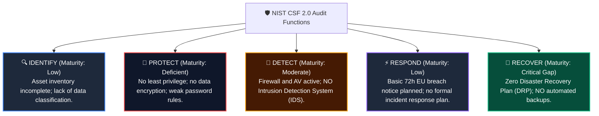
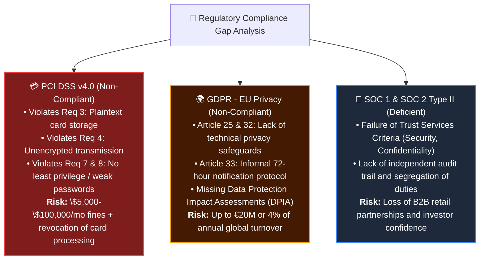
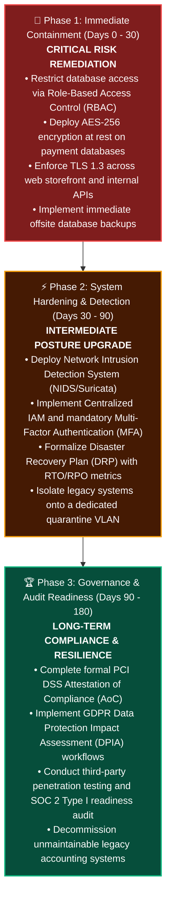

# 🛡️ Botium Toys — Internal Security Audit & Risk Assessment Report

  
  
  
  

---

## 📑 Executive Summary & Stakeholder Memorandum

**TO:** IT Manager, Chief Information Security Officer (CISO) & Executive Stakeholders  
**FROM:** Eduardo de Souza Marques — Cybersecurity & GRC Analyst  
**DATE:** November 5, 2026  
**SUBJECT:** Internal Security Audit: Comprehensive Findings, Compliance Gap Analysis & Remediation Roadmap  

An internal security audit was conducted on **Botium Toys** to evaluate its existing cybersecurity posture following the expansion of its retail storefront, warehouse operations, and international e-commerce platform. 

The audit evaluated existing assets, technical and administrative controls, and regulatory adherence against the **NIST Cybersecurity Framework (NIST CSF 2.0)**, **PCI DSS v4.0**, **GDPR**, and **SOC 1 / SOC 2** standards. 

### 🚨 Key Audit Takeaway
> **Current Organizational Risk Score: 8 / 10 (High Risk).**  
> While Botium Toys has successfully implemented perimeter network filtering (firewalls), endpoint antivirus, and physical facility security, **critical vulnerabilities exist in access control, data encryption, disaster recovery, and regulatory compliance**. Most notably, unencrypted customer credit card data and PII/SPII are accessible across internal systems, exposing the organization to catastrophic breach risks, merchant processing suspension, and severe regulatory fines.

---

## 🎯 1. Scope, Goals & Critical Asset Inventory

### Audit Scope
The scope encompasses Botium Toys’ entire information security program across physical facilities, on-premises infrastructure, internal networks, end-user equipment, databases, and e-commerce transactional systems.

### Core Objectives
1. Inventory and classify critical organizational assets and data flows.
2. Complete a comprehensive **Controls and Compliance Assessment Matrix**.
3. Identify gaps in technical, administrative, and physical safeguards.
4. Establish an actionable, prioritized remediation roadmap aligned with international compliance frameworks.

### Asset Inventory Summary

| Asset Classification | Asset Category | Description & Criticality | Current Security Status |
| :--- | :--- | :--- | :--- |
| **Data Assets (Tier 1 - Critical)** | Cardholder Data & Customer PII/SPII | Credit card numbers, cardholder names, expiration dates, customer addresses. | ❌ **Unencrypted at rest and in transit.** Broad internal employee access. |
| **System Assets (Tier 1 - Critical)** | Databases & E-Commerce Web Engines | Relational customer database, payment processing pipelines, web storefront. | ⚠️ Protected by perimeter firewall, but lacks intrusion detection (IDS) and database encryption. |
| **Hardware & Endpoints (Tier 2 - High)** | Workstations & Remote Laptops | Employee laptops, warehouse desktops, remote devices, docking stations. | ⚠️ Antivirus installed; password policy weak, no centralized IAM/MFA enforcement. |
| **Legacy Systems (Tier 2 - High)** | End-of-Life Infrastructure | Deprecated legacy accounting and inventory modules requiring manual supervision. | ❌ No formal patch schedule; unsegmented from main production network. |
| **Physical Facilities (Tier 3 - Medium)** | Main Offices & Warehouse | Storefront, corporate headquarters, and product warehouse. | ✅ **Secured:** Functional locks, CCTV surveillance, and fire suppression systems in place. |

---

## 📊 2. Risk Assessment Methodology & Scoring (NIST CSF 2.0)

The risk assessment aligns with the five functions of the **NIST Cybersecurity Framework (CSF)**:

### Risk Calculation Breakdown
* **Likelihood of Occurrence:** **High (8/10)** — Unencrypted sensitive databases, broad employee access, and absence of intrusion monitoring make unauthorized access or data exfiltration highly probable.
* **Potential Business Impact:** **High (8/10)** — Non-compliance penalties under PCI DSS and GDPR, combined with operational shutdown during a ransomware incident (zero backups), could threaten corporate solvency.
* **Overall Inherent Risk Score:** **8 / 10 (HIGH RISK)** ➔ **Target Residual Risk Post-Remediation: 2 / 10 (LOW RISK)**.

---

## ✅ 3. Comprehensive Controls Assessment Checklist

| Control Name | Control Type | Currently in Place? | Observed Gap / Technical Deficiency |
| :--- | :---: | :---: | :--- |
| **Principle of Least Privilege** | Technical / Admin | ❌ **NO** | All employees have unrestricted access to internally stored customer PII and cardholder databases. |
| **Separation of Duties** | Administrative | ❌ **NO** | Critical financial, operational, and administrative duties overlap without dual-authorization checks. |
| **Data Encryption (At Rest)** | Technical | ❌ **NO** | Credit card details and customer SPII are stored in plain text inside local databases. |
| **Data Encryption (In Transit)** | Technical | ❌ **NO** | Cardholder transactions transmitted internally lack end-to-end TLS 1.3 encryption. |
| **Password Complexity Policy** | Administrative | ❌ **NO** | Password rules are nominal and do not meet minimum standards (length, complexity, rotation). |
| **Centralized IAM / Password Management** | Technical | ❌ **NO** | No centralized directory (IAM/SSO); frequent reset tickets impair user productivity. |
| **Multi-Factor Authentication (MFA)** | Technical | ❌ **NO** | Single-factor password authentication only on endpoints and administrative consoles. |
| **Intrusion Detection System (IDS)** | Technical | ❌ **NO** | Perimeter firewall exists, but no NIDS/HIDS to detect internal lateral movement or anomalies. |
| **Disaster Recovery Plan (DRP) & BCP** | Administrative | ❌ **NO** | No documented recovery time objectives (RTO/RPO); no continuity strategy. |
| **Automated Data Backups** | Technical | ❌ **NO** | Critical business databases and configurations are not backed up. Ransomware would cause total loss. |
| **Legacy System Maintenance Schedule** | Operational | ❌ **NO** | End-of-life legacy modules are monitored manually without clear intervention or patch protocols. |
| **Firewall & Perimeter Filtering** | Technical | ✅ **YES** | Rule-based stateful firewall deployed, filtering unauthorized inbound network traffic. |
| **Antivirus / Anti-Malware** | Technical | ✅ **YES** | Antivirus software installed across all workstations and monitored by IT. |
| **Physical Access Security & Locks** | Physical | ✅ **YES** | Storefront, main office, and warehouse secured with physical deadbolts and access controls. |
| **CCTV Surveillance** | Physical | ✅ **YES** | Modern closed-circuit cameras monitoring perimeter and inventory storage areas. |
| **Fire Detection & Suppression** | Physical | ✅ **YES** | Functioning smoke alarms and fire suppression systems installed across premises. |

---

## ⚖️ 4. Regulatory Compliance & Exposure Analysis

---

## 🛠️ 5. Prioritized Remediation Roadmap

To remediate these vulnerabilities efficiently, the action items are structured into three phases:

---

## 📌 Deliverables Included in this Project

* 📄 **[Executive Stakeholder Memorandum](docs/Executive_Summary_Memo.md):** 1-page executive memo for CISO and board review.
* 📋 **[Controls & Compliance Matrix](docs/Controls_and_Compliance_Checklist.md):** Granular breakdown of technical, administrative, and physical controls.
* 📕 **[Full Comprehensive Audit Report (Markdown)](docs/Botium_Toys_Security_Audit_Report.md):** Detailed technical dossier.
* 📑 **[Download Official PDF Audit Report](Botium_Toys_Security_Audit_Report.pdf):** Clean, publication-ready PDF audit deliverable.

---

## 👤 Author & Professional Background

**Eduardo de Souza Marques**  
*Information Security, GRC & Forensic Risk Analyst*  
* Over 13 years of complex investigative and evidence-custody experience.
* Specializing in Governance, Risk and Compliance (GRC), NIST CSF 2.0, ISO/IEC 27001:2022, and Cloud Security.
* CompTIA Security+ (SY0-701) & Google Cybersecurity Professional Certificate.

📫 **Connect:** [LinkedIn Profile](https://www.linkedin.com/in/edusouzamarques/) · [Cybersecurity Hub](https://edusouzamarques.github.io/cybersec/)
