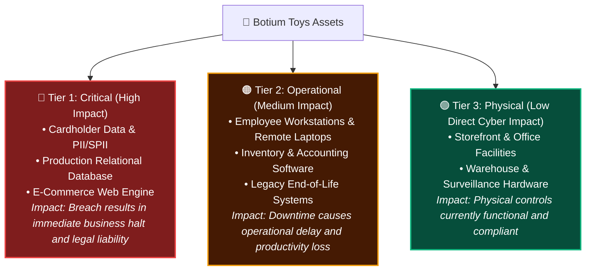
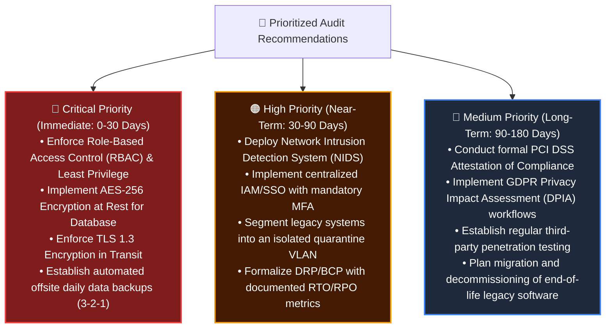

# 📕 Botium Toys: Comprehensive Internal Security Audit Report

**Lead Auditor:** Eduardo de Souza Marques  
**Certification / Specialization:** Cybersecurity & GRC Analyst (CompTIA Security+ · Google Cybersecurity)  
**Assessment Date:** November 2026  
**Target Organization:** Botium Toys Inc.  
**Classification:** Confidential  

---

## 1. Introduction & Background

Botium Toys is a rapidly expanding retail toy company operating a physical storefront, an adjoining inventory warehouse, and an international e-commerce platform. In response to recent commercial expansion—specifically expanding online sales to customers in the United States and the European Union—Botium Toys commissioned this comprehensive internal security audit.

The primary mandate is to evaluate current information security controls, quantify organizational risk exposure, evaluate regulatory compliance, and produce an actionable remediation roadmap aligned with the **NIST Cybersecurity Framework (NIST CSF 2.0)**.

---

## 2. Audit Scope & Asset Identification

### 2.1 Scope Definition
The audit evaluated the entirety of Botium Toys’ security operations, including:
* **Physical Infrastructure:** Retail storefront, corporate administrative offices, and warehouse facilities.
* **Network & Systems Architecture:** Perimeter defenses, internal routing, internet access points, and server infrastructure.
* **Endpoint Ecosystem:** On-premises desktops, remote employee laptops, mobile devices, and peripherals.
* **Data Assets & Applications:** Customer transactional databases, accounting software, inventory management systems, and e-commerce web applications.
* **Legacy Systems:** End-of-life infrastructure currently supported through manual human intervention.

### 2.2 Asset Classification & Business Impact Analysis

---

## 3. Risk Assessment & Analysis

### 3.1 Threat Modeling & Vulnerability Findings

1. **Vulnerability V-01 (Excessive Internal Privilege):**  
   All employees have unrestricted access to internal data repositories. Non-technical staff (warehouse and retail personnel) possess read and write capabilities over sensitive customer databases.  
   *Threat Scenario:* Malicious insider or single phishing victim grants an adversary immediate enterprise-wide access.

2. **Vulnerability V-02 (Unencrypted Sensitive Data):**  
   Customer payment card details (Primary Account Numbers, expiration dates) and Sensitive PII (SPII) are processed and stored locally in plaintext.  
   *Threat Scenario:* Any unauthorized access or compromised server immediately exposes thousands of payment cards, triggering mandatory disclosure and merchant penalties.

3. **Vulnerability V-03 (Absence of Business Continuity Controls):**  
   There is zero documented Disaster Recovery Planning (DRP), zero business continuity architecture, and no regular data backups.  
   *Threat Scenario:* A ransomware attack would permanently destroy operational data, causing unrecoverable business failure.

4. **Vulnerability V-04 (Blind Spots in Network Telemetry):**  
   While a basic perimeter firewall is deployed, no Intrusion Detection System (IDS) or centralized log aggregation is implemented.  
   *Threat Scenario:* Adversaries can execute internal reconnaissance and lateral movement undetected for months (uncontrolled *Dwell Time*).

### 3.2 Quantitative & Qualitative Risk Rating
* **Likelihood:** 8 / 10 (High Probability of exploit due to lack of internal controls)
* **Impact:** 8 / 10 (Severe financial, operational, and regulatory consequences)
* **Overall Inherent Risk Score:** **8 / 10 (HIGH RISK)**

---

## 4. Regulatory & Compliance Evaluation

### 4.1 Payment Card Industry Data Security Standard (PCI DSS v4.0)
* **Finding:** Non-Compliant.
* **Violations:**
  * **Requirement 3:** Failure to protect stored cardholder data (storing plaintext PANs).
  * **Requirement 4:** Failure to protect cardholder data with strong cryptography during transit over open, public networks.
  * **Requirement 7 & 8:** Failure to restrict access to system components and cardholder data by business need-to-know, and lack of strong authentication/password complexity.
* **Exposure:** Monthly non-compliance penalties ranging from \$5,000 to \$100,000, mandatory forensic investigation expenses, and potential termination of credit card acceptance agreements.

### 4.2 General Data Protection Regulation (GDPR)
* **Finding:** Non-Compliant.
* **Violations:**
  * **Article 25 (Data Protection by Design & Default):** Processing customer PII without encryption or access controls.
  * **Article 32 (Security of Processing):** Inadequate technical and organizational measures to ensure a level of security appropriate to the risk.
  * **Article 33 (Breach Notification):** While an informal 72-hour notice concept exists, no tested incident response workflow or data mapping exists to identify impacted EU data subjects.
* **Exposure:** Fines up to €20 million or 4% of total worldwide annual turnover, whichever is higher.

### 4.3 AICPA SOC 1 & SOC 2 Type II
* **Finding:** Deficient.
* **Gaps:** Absence of formal segregation of duties between operational leadership and payroll; lack of change management logging; lack of continuous control monitoring.
* **Exposure:** Failure to pass vendor risk assessments required by prospective enterprise B2B retail partners.

---

## 5. Strategic Recommendations & Action Plan

---

## 6. Conclusion & Executive Sign-off

The vulnerabilities identified within Botium Toys are typical for high-growth e-commerce enterprises that have prioritized commercial expansion over information security governance. However, the identified gaps present unacceptable legal, operational, and financial risks.

Implementing the recommendations outlined in this report will establish a resilient defense-in-depth posture, ensure adherence to PCI DSS, GDPR, and SOC frameworks, and successfully reduce Botium Toys’ risk score to **2 / 10**.

**Lead Auditor:**  
Eduardo de Souza Marques  
*GRC & Cybersecurity Analyst*  
*November 5, 2026*
